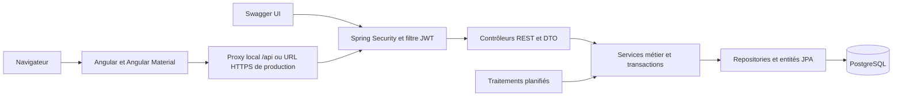
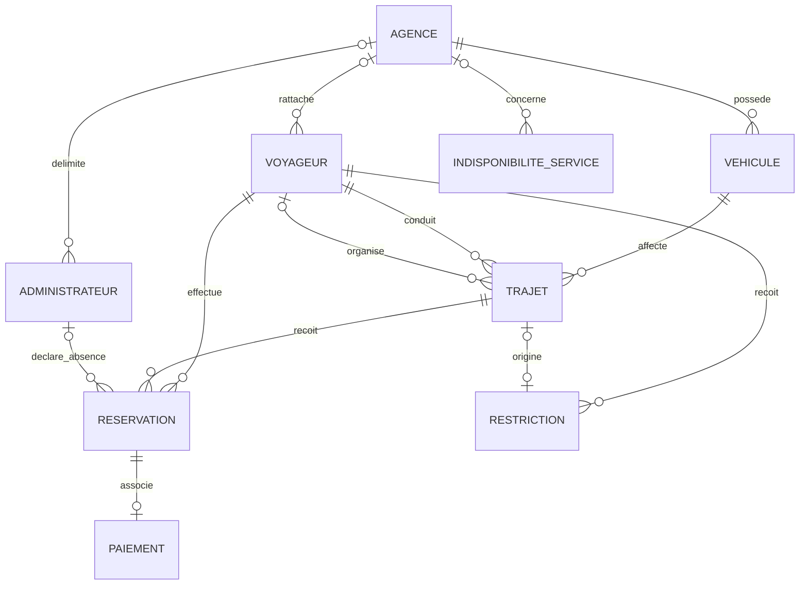

# TransportMultiple

TransportMultiple est une application de gestion du covoiturage public et privé pour un réseau d’agences en Belgique. Elle centralise les disponibilités des véhicules et chauffeurs, les trajets, les invitations, les réservations, les paiements simulés et les sanctions. Son objectif est de préserver la capacité des trajets et la cohérence des réservations tout en limitant les accès au périmètre de chaque utilisateur.

- Le **voyageur** recherche des trajets, réserve, règle un billet simulé et consulte son profil et son historique. Un voyageur habilité peut proposer un trajet et gérer ses invitations.
- L’**administrateur d’agence** gère les ressources et les opérations relevant de son agence.
- L’**administrateur global** dispose d’un périmètre transversal et des droits de gestion du réseau d’agences.

## Sommaire

- [Technologies](#technologies)
- [Architecture](#architecture)
- [Prérequis](#prérequis)
- [Installation](#installation)
- [PostgreSQL et Docker](#postgresql-et-docker)
- [Backend Spring Boot](#backend-spring-boot)
- [Frontend Angular](#frontend-angular)
- [Liens d’accès](#liens-daccès)
- [Comptes de démonstration](#comptes-de-démonstration)
- [Permissions par profil](#permissions-par-profil)
- [Règles métier](#règles-métier)
- [API REST et Swagger](#api-rest-et-swagger)
- [Base de données](#base-de-données)
- [Tests et validation](#tests-et-validation)
- [Dépannage](#dépannage)
- [Démarrage rapide](#démarrage-rapide)

## Technologies

Les versions de bibliothèques proviennent du POM Maven et du verrou npm. La colonne d’usage distingue les cibles configurées des versions observées sur le poste de validation.

| Technologie | Version | Usage |
| --- | --- | --- |
| Java | 21, testé avec 21.0.9 | Compilation et exécution backend |
| Spring Boot et Spring Security | 3.5.16 et 6.5.11 | API REST, authentification et contrôle des accès |
| JWT et mots de passe | JJWT 0.12.5 et BCrypt | Jetons signés et hachage des mots de passe |
| Maven | 3.9.16 via le Wrapper | Compilation, tests et production du JAR |
| Hibernate et PostgreSQL JDBC | 6.6.53.Final et 42.7.12 | Modèle JPA et accès PostgreSQL |
| PostgreSQL | 15, image `postgres:15` | Stockage local, validation et persistance |
| Tomcat et Jackson | 10.1.62 et BOM 2.21.9 | Serveur embarqué et JSON REST |
| Angular et Angular CLI | 21.2.26 et 21.2.30 | Application web et outillage |
| Angular Material et CDK | 21.2.14 | Composants et comportements d’interface |
| TypeScript, RxJS et Tailwind CSS | 5.9.3, 7.8.2 et 3.4.19 | Typage, flux et styles |
| Node.js et npm | Node.js 24 en CI, testés avec 24.19.0 et npm 11.17.0 | Dépendances et commandes Angular |
| Docker et Compose | Moteur 29.9.3 et Compose 5.7.1 observés | PostgreSQL local et image du backend |
| Swagger et OpenAPI | Springdoc 2.8.8, OpenAPI 3 | Interface de consultation et document JSON |
| Tests backend | JUnit 5.12.2, Mockito 5.17.0, AssertJ 3.27.7, H2 2.3.232 et PostgreSQL 15 | Tests unitaires, MockMvc et intégration |
| Tests frontend | Vitest 4.1.12 et jsdom 28.1.0 | Tests des composants, services et protections de routes |

## Architecture

```text
.
├── pom.xml et mvnw.cmd                 Build Maven du backend à la racine
├── src/
│   ├── main/java/com/transport/gestiontransport/
│   │   ├── GestionTransportApplication.java et DataInitializer.java
│   │   ├── config/                     Spring, JWT, CORS, OpenAPI et garde de schéma
│   │   ├── controller/                 Entrées REST et codes HTTP
│   │   ├── dto/ et mapper/             Contrats JSON et conversions
│   │   ├── service/                    Règles métier et transactions
│   │   ├── repository/ et entity/      Persistance et mappings JPA
│   │   └── scheduler/ et exception/    Traitements périodiques et erreurs REST
│   ├── main/resources/                 Configuration locale et profil production
│   ├── test/java/                      Tests du backend
│   └── test/resources/                 Paramètres et données SQL de test
├── frontend/
│   ├── src/app/core/                   API, sessions, guards et intercepteurs
│   ├── src/app/features/               Accueil, voyageur et administration
│   ├── src/app/shared/                 Composants partagés
│   └── proxy.conf.json                 Proxy local vers Spring Boot
├── scripts/migrations/                Scripts SQL exécutés explicitement
├── start-local.ps1 et commandes.ps1    Démarrage et menu Windows
├── docker-compose.yml et Dockerfile    PostgreSQL local et image du backend
└── .github/workflows/ et docs/         Contrôles et procédures
```



Les guards Angular pilotent la navigation. Spring Security vérifie le JWT, puis les contrôleurs et services contrôlent le rôle, l’agence et la ressource. Les sessions HTTP sont stateless. Les traitements planifiés réutilisent les services métier.

## Prérequis

Installer Git, Java 21 et Docker Desktop avec Compose prenant en charge `--wait`. Utiliser Windows PowerShell 5.1 ou PowerShell 7. Node.js 24 est la cible CI. Angular déclare aussi les branches Node.js 20 à partir de 20.19 et 22 à partir de 22.12 dans le verrou actuel.

```powershell
git --version
java --version
docker version
docker compose version
node --version
npm.cmd --version
```

Dans IntelliJ IDEA, sélectionner le JDK 21 pour le projet et le lanceur Maven. Après clonage, `.\mvnw.cmd -v` vérifie la version du Wrapper et le JDK utilisé.

## Installation

```powershell
git clone https://github.com/Zoom225/GestionTransport-Multiple.git
Set-Location GestionTransport-Multiple
.\mvnw.cmd -B -ntp dependency:resolve
npm.cmd --prefix frontend ci
```

Utiliser une révision qui contient `start-local.ps1` et `commandes.ps1`. Les commandes Docker et Maven partent de la racine. Pour les commandes npm sans `--prefix frontend`, se placer dans `frontend`.

Créer un fichier local `.env` à la racine pour Compose. Le dépôt ignore ce fichier et ne fournit pas de `.env.example`. Les variables destinées à un lancement Maven direct ou à IntelliJ doivent être disponibles dans l’environnement du processus Java.

| Variable | Usage et valeur |
| --- | --- |
| `TRANSPORT_DB_VOLUME` | Nom exact du volume PostgreSQL externe. Obligatoire pour Compose. |
| `DB_URL` | URL JDBC. Défaut local `jdbc:postgresql://localhost:5440/transportService`. |
| `DB_USER`, `DB_PASSWORD` | Identifiants PostgreSQL de l’installation. Le lanceur reprend les valeurs résolues par Compose lorsque ces variables ne sont pas fournies. |
| `JWT_SECRET` | Clé obligatoire au démarrage de Java. Le lanceur crée une clé locale temporaire lorsqu’elle manque. IntelliJ et Maven lancé directement doivent la recevoir explicitement. |
| `DEMO_DATA_ENABLED` | `false` par défaut. Utiliser `true` avec le profil `dev` uniquement dans le parcours isolé de démonstration. |
| `DEMO_PASSWORD` | Valeur choisie pour les huit comptes sur une base de démonstration neuve. Au moins 12 caractères et au plus 72 octets UTF-8. |
| `CORS_ALLOWED_ORIGINS` | Origines frontend exactes du profil production. |
| `TRANSPORT_API_BASE_URL` | URL HTTPS de production de l’API, terminée par `/api`, lors de la construction du frontend hébergé. |

Préparer PostgreSQL avant le backend. Les données métier sont conservées dans le volume externe. L’initialisation de démonstration est une étape distincte décrite [ci-dessous](#comptes-de-démonstration).

## PostgreSQL et Docker

Compose démarre le service `postgres` dans le conteneur `gestiontransport-db`. Le port hôte **5440** est publié vers **5432** et la base locale est **`transportService`**. Le port est publié sans liaison explicite à l’interface de boucle locale. Utiliser cette configuration sur un poste de développement protégé.

Pour un poste existant, relever le nom du volume associé à `/var/lib/postgresql/data`.

```powershell
docker inspect gestiontransport-db --format '{{range .Mounts}}{{println .Destination .Name}}{{end}}'
```

Pour une installation neuve uniquement, créer le volume suivant. Renseigner ensuite `TRANSPORT_DB_VOLUME=gestiontransport-db-data`, `DB_USER` et `DB_PASSWORD` dans `.env` avec les identifiants locaux choisis. Pour une installation existante, renseigner le nom relevé et conserver les identifiants PostgreSQL de ce volume. Les variables d’initialisation PostgreSQL prennent effet sur un volume neuf.

```powershell
docker volume create gestiontransport-db-data
```

Démarrage et contrôles depuis la racine du dépôt :

```powershell
docker compose config --quiet
docker compose up -d --no-recreate --wait --wait-timeout 60 postgres
docker compose ps
docker compose logs --tail=100 postgres
Test-NetConnection -ComputerName localhost -Port 5440
```

Arrêt et redémarrage du service, à exécuter selon l’action souhaitée :

```powershell
docker compose stop postgres
```

```powershell
docker compose restart postgres
docker compose ps
```

> [!WARNING]
> Conserver le volume existant et éviter `docker compose down -v` sur une installation contenant des données. Si le garde détecte un schéma historique ou ambigu, utiliser la [procédure PostgreSQL sur une copie](docs/finalisation/validation-postgresql.md).

Le [Dockerfile](Dockerfile) construit séparément une image du backend en Java 21. Le service Compose PostgreSQL et le build Angular ont leurs propres commandes.

```powershell
docker build --tag transportmultiple:local .
```

## Backend Spring Boot

Le backend se trouve à la racine. Le lanceur vérifie Java, le port HTTP et Docker, attend PostgreSQL, prépare les variables locales, compile puis lance Spring Boot. Laisser le terminal ouvert. Utiliser **Ctrl+C** pour arrêter le backend.

```powershell
powershell -NoProfile -ExecutionPolicy Bypass -File .\start-local.ps1
```

Pour résoudre les dépendances, compiler puis produire un JAR vérifié par les tests :

```powershell
.\mvnw.cmd -B -ntp dependency:resolve
.\mvnw.cmd -B -ntp clean compile
.\mvnw.cmd -B -ntp clean verify
```

Le JAR se trouve dans `target/gestiontransport-multiple-0.0.1-SNAPSHOT.jar`. Pour un démarrage direct après configuration de PostgreSQL et de `JWT_SECRET` dans le terminal :

```powershell
.\mvnw.cmd -B -ntp '-Dspring-boot.run.jvmArguments=-Dspring.devtools.restart.enabled=false' spring-boot:run
```

```powershell
Invoke-RestMethod http://localhost:8080/actuator/health
```

> [!TIP]
> Le [script IntelliJ](scripts/configure-intellij-jwt.ps1) peut préparer la clé dans la configuration locale. Une clé du terminal concerne les processus démarrés depuis ce terminal. Le profil `production` a ses paramètres dans [le guide de déploiement](docs/deploiement-production.md).

## Frontend Angular

```powershell
Set-Location frontend
npm.cmd ci
npm.cmd test
npm.cmd run build
npm.cmd start
```

Garder le terminal Angular ouvert et ouvrir [http://localhost:4200](http://localhost:4200). Le [proxy local](frontend/proxy.conf.json) transmet `/api` à Spring Boot sur le port 8080. Le build de production est dans `frontend/dist/frontend/browser`. Arrêter Angular avec **Ctrl+C** avant un nouveau `npm.cmd ci` sous Windows.

Depuis la racine, le [menu PowerShell](commandes.ps1) permet aussi d’installer, compiler, tester et démarrer les composants. Ouvrir un terminal par serveur.

```powershell
powershell -NoProfile -ExecutionPolicy Bypass -File .\commandes.ps1
```

```powershell
powershell -NoProfile -ExecutionPolicy Bypass -File .\commandes.ps1 -Action DemarrerFrontend -PortFrontend 4202
```

## Liens d’accès

| Service | URL | Description |
| --- | --- | --- |
| Frontend Angular | [http://localhost:4200](http://localhost:4200) | Accueil et accès aux espaces |
| Connexion voyageur | [http://localhost:4200/voyageur](http://localhost:4200/voyageur) | Connexion par matricule |
| Connexion administration | [http://localhost:4200/admin/login](http://localhost:4200/admin/login) | Connexion par e-mail |
| Backend Spring Boot | [Catalogue REST](http://localhost:8080/api/trajets/villes) · [Santé](http://localhost:8080/actuator/health) | API sous `http://localhost:8080/api` et contrôle de disponibilité |
| Swagger UI | [http://localhost:8080/swagger-ui.html](http://localhost:8080/swagger-ui.html) | Redirection vers `/swagger-ui/index.html` |
| OpenAPI JSON | [http://localhost:8080/v3/api-docs](http://localhost:8080/v3/api-docs) | Spécification REST |
| Configuration Swagger | [http://localhost:8080/v3/api-docs/swagger-config](http://localhost:8080/v3/api-docs/swagger-config) | Configuration de l’interface Swagger |
| PostgreSQL | `localhost:5440` | Base Compose `transportService` |

## Comptes de démonstration

Le [code d’initialisation](src/main/java/com/transport/gestiontransport/DataInitializer.java) crée les comptes ci-dessous sous le profil `dev`, sur une base PostgreSQL vide dont le nom commence par `transport_demo_` ou `issue1_validation_`. Le mode est désactivé par défaut. Dans le parcours ci-dessous, le mot de passe de chaque compte est **la valeur réellement saisie pour `DEMO_PASSWORD` avant le premier démarrage**. Les valeurs personnelles restent locales et le stockage utilise BCrypt.

| Profil | Identifiant de connexion | Mot de passe de démonstration | Rôle | Permissions et restrictions |
| --- | --- | --- | --- | --- |
| Chauffeur voyageur | `V1001` | `DEMO_PASSWORD` saisi | `VOYAGEUR`, `VIP` | Habilité à proposer et chauffeur des trajets de démonstration |
| Voyageur organisateur | `V1002` | `DEMO_PASSWORD` saisi | `VOYAGEUR`, `VIP` | Habilité à proposer et organisateur désigné de trajets de démonstration |
| Voyageur local | `L10001` | `DEMO_PASSWORD` saisi | `VOYAGEUR`, `LOCAL` | Réservations dans son agence, sans habilitation de proposition initiale |
| Voyageur libre | `F10001` | `DEMO_PASSWORD` saisi | `VOYAGEUR`, `LIBRE` | Réservation dans la fenêtre libre, sans habilitation de proposition initiale |
| Voyageur sanctionné | `F10002` | `DEMO_PASSWORD` saisi | `VOYAGEUR`, `LIBRE` | Débiteur de 100 € à l’initialisation. Profil et règlement accessibles. La dette et la restriction conditionnent sa participation. |
| Administrateur principal | `admin@transp.com` | `DEMO_PASSWORD` saisi | `ADMIN`, `GLOBAL` | Périmètre du réseau et gestion des agences |
| Administrateur secondaire | `admin.lyon@transp.com` | `DEMO_PASSWORD` saisi | `ADMIN`, `AGENCE` | Limité à l’agence de démonstration sur une base neuve |
| Administrateur secondaire | `admin.paris@transp.com` | `DEMO_PASSWORD` saisi | `ADMIN`, `AGENCE` | Même rattachement que l’autre administrateur secondaire sur une base neuve |

Les adresses administrateur sont les identifiants définis pour ce jeu de données. Le rattachement des deux comptes secondaires dépend des données initialisées et leurs alias ne déterminent pas leur agence. Utiliser le matricule sur `/voyageur` et l’e-mail sur `/admin/login`.

Dans un terminal backend dédié, préparer une **nouvelle base vide** après le démarrage de Compose. Choisir un nouveau suffixe si le nom est déjà utilisé. Exécuter ces commandes avant de lancer le backend :

```powershell
$rolePostgres = (docker compose exec -T postgres printenv POSTGRES_USER).Trim()
docker compose exec -T postgres createdb -U $rolePostgres transport_demo_local
if ($LASTEXITCODE -ne 0) { throw 'Choisir un nouveau nom pour la base de démonstration.' }
$env:SPRING_PROFILES_ACTIVE = 'dev'
$env:DB_URL = 'jdbc:postgresql://localhost:5440/transport_demo_local'
$env:DEMO_DATA_ENABLED = 'true'
$motDePasseDemo = Read-Host 'Mot de passe de démonstration, minimum 12 caractères' -AsSecureString
$env:DEMO_PASSWORD = [Net.NetworkCredential]::new('', $motDePasseDemo).Password
powershell -NoProfile -ExecutionPolicy Bypass -File .\start-local.ps1
```

> [!IMPORTANT]
> Sur une base déjà initialisée, redéfinir `DEMO_PASSWORD` ne change pas les hachages existants. Pour retrouver un jeu de comptes avec un mot de passe connu, créer une autre base de démonstration vide. Le code permet aussi des mots de passe distincts par profil avec `DEMO_ADMIN_PASSWORD` et `DEMO_VOYAGEUR_PASSWORD` quand `DEMO_PASSWORD` est absent. Le profil `production` désactive la démonstration.

## Permissions par profil

| Fonctionnalité | Voyageur | Administrateur GLOBAL | Administrateur AGENCE |
| --- | --- | --- | --- |
| Chercher les trajets publics et consulter les catalogues | Public | Public | Public |
| Consulter le profil personnel, les réservations, les paiements et les sanctions du voyageur | Données personnelles | Gestion administrative dans les routes prévues | Gestion des voyageurs de sa propre agence |
| Proposer un trajet et choisir un chauffeur | Proposition si habilité. Chauffeur déduit du JWT. | Création avec un chauffeur admissible choisi | Création avec un chauffeur et un véhicule dans son périmètre |
| Inviter sur un trajet privé | Organisateur ou chauffeur affecté, avec contrôle d’admissibilité de l’invité | Accès aux routes de gestion autorisées | Accès aux routes de gestion autorisées dans son agence |
| Modifier un trajet via la route voyageur | Organisateur désigné. Pour un historique sans organisateur, chauffeur affecté. | Route réservée au voyageur | Route réservée au voyageur |
| Convertir un trajet privé en public via la route dédiée | Consentement à la publication via la proposition | Autorisé si le consentement, le statut et le délai conviennent | Même règle dans son agence |
| Créer, modifier ou supprimer une agence | Aucun accès | Autorisé | Aucun accès en écriture |
| Gérer les véhicules, voyageurs et indisponibilités | Consultation publique des véhicules et accès aux parcours personnels | Toutes les agences, y compris les indisponibilités globales | Propre agence et lecture des indisponibilités globales |
| Déclarer une absence | Aucun accès | Autorisé selon le statut de la réservation et du trajet | Même règle pour un trajet de son agence |

La fenêtre de réservation dépend de la catégorie du voyageur. Les protections Angular pilotent l’affichage des pages et le backend vérifie les opérations. Une lecture publique de catalogue ne donne aucun droit d’écriture.

## Règles métier

- **Voyageur et périmètre**. Le matricule est unique. Les catégories VIP, LOCAL et LIBRE disposent de fenêtres respectives de **21, 14 et 5 jours**. Un LOCAL réserve dans son agence. Les restrictions actives ou les dettes peuvent bloquer la participation.
- **Création d’un trajet**. Départ et destination doivent être différents. Le véhicule et le chauffeur sont obligatoires. Les horaires d’agence, fermetures et chevauchements sont contrôlés. Le chauffeur et l’organisateur peuvent être distincts.
- **Accès et capacité**. Les invitations privées contrôlent l’identité de l’organisateur ou du chauffeur et l’admissibilité du passager. Un trajet accepte **quatre clients**, chauffeur exclu. Quatre confirmations donnent le statut `COMPLET`.
- **Réservation et paiement**. La demande reste en attente jusqu’au paiement individuel simulé de **25 €**, réservé au titulaire. Une opération verrouillée contrôle la dernière place, la réservation active et le paiement. Sans paiement, le délai par défaut est de **30 minutes** via `RESERVATION_PAYMENT_TTL=PT30M`.
- **Annulation et historique**. Les annulations autorisées libèrent la place confirmée et mettent à jour le paiement selon son état, en conservant les traces.
- **Trajet privé incomplet**. Dans les **24 heures** avant le départ, la publication respecte le consentement. En son absence et lorsque les conditions sont réunies, une pénalité de **100 €** vise l’organisateur désigné et une suspension de **168 heures** s’applique une seule fois. Payer la pénalité ne raccourcit pas la suspension.
- **Sanctions optionnelles**. Annulation tardive, absence et annulations répétées sont désactivées par défaut. La déclaration d’absence par un administrateur habilité existe indépendamment de la sanction automatique.

Les traitements périodiques démarrent après une minute et ont un délai de 60 secondes par défaut. Les preuves, limites et décisions en attente figurent dans le [rapport RM01 à RM30](docs/finalisation/validation-metier.md).

## API REST et Swagger

| Méthode HTTP | Endpoint | Description | Authentification | Rôle autorisé |
| --- | --- | --- | --- | --- |
| POST | `/api/auth/login` | Connexion par e-mail, obtention du JWT | Identifiants | Administrateur |
| POST | `/api/voyageurs/login` | Connexion par matricule | Identifiants | Voyageur |
| GET | `/api/trajets/public` | Rechercher les trajets publics | Publique | Tous |
| GET | `/api/trajets/villes` | Catalogue des villes | Publique | Tous |
| GET | `/api/agences`, `/api/vehicules` | Catalogues d’agences et véhicules | Publique | Tous |
| POST | `/api/agences` | Créer une agence | Bearer JWT | GLOBAL |
| POST | `/api/vehicules` | Ajouter un véhicule | Bearer JWT | ADMIN, périmètre vérifié |
| GET | `/api/trajets` | Lister les trajets de gestion | Bearer JWT | ADMIN, périmètre vérifié |
| GET | `/api/trajets/{id}` | Consulter un trajet | Bearer JWT | VOYAGEUR admissible ou ADMIN dans son périmètre |
| POST | `/api/trajets` | Proposer ou créer un trajet | Bearer JWT | VOYAGEUR habilité ou ADMIN |
| PUT | `/api/trajets/{id}` | Modifier un trajet | Bearer JWT | VOYAGEUR responsable |
| PATCH | `/api/trajets/{id}/convert-public` | Publier un trajet privé éligible | Bearer JWT | ADMIN, périmètre vérifié |
| POST | `/api/reservations` | Déposer une demande personnelle | Bearer JWT | VOYAGEUR |
| POST | `/api/reservations/private-invites` | Inviter des voyageurs | Bearer JWT | VOYAGEUR organisateur ou chauffeur affecté |
| PATCH | `/api/reservations/{id}/cancel` | Annuler une réservation selon les règles | Bearer JWT | VOYAGEUR titulaire ou chauffeur autorisé |
| POST | `/api/reservations/{id}/absence` | Déclarer une absence | Bearer JWT | ADMIN, périmètre vérifié |
| POST | `/api/paiements/reservation/{reservationId}/pay` | Simuler le paiement d’un billet | Bearer JWT | VOYAGEUR titulaire |
| GET | `/api/voyageurs/me`, `/api/voyageurs/me/sanctions` | Profil et sanctions personnels | Bearer JWT | VOYAGEUR |
| POST | `/api/trajets/{id}/penalite/pay` | Régler une pénalité de trajet | Bearer JWT | VOYAGEUR organisateur débiteur |
| GET | `/api/indisponibilites-service` | Consulter les fermetures selon le périmètre | Bearer JWT | ADMIN |

Dans [Swagger UI](http://localhost:8080/swagger-ui.html), appeler la route de connexion avec le profil choisi, récupérer le champ `token` et le coller dans **Authorize → Bearer Auth** sans préfixe. Swagger ajoute `Authorization: Bearer …` aux appels. Les contrôles de rôle et de propriété restent applicables. Les accès au document Swagger sont publics dans la configuration actuelle. Consulter [OpenAPI JSON](http://localhost:8080/v3/api-docs) pour les DTO et la liste complète.

## Base de données

Les tables principales sont `agences`, `vehicules`, `voyageurs`, `administrateurs`, `trajets`, `reservations`, `paiements`, `restrictions` et `indisponibilites_service`.



Les clés étrangères relient les ressources obligatoires. Les matricules et l’e-mail administrateur sont uniques. Le paiement est lié en un-à-un à la réservation. Les montants utilisent `BigDecimal` et des colonnes décimales à deux chiffres après la virgule. La migration d’invariants définit un index d’unicité des réservations actives et des index de recherche et de créneau.

Hibernate utilise `ddl-auto=update` dans la configuration locale. Le garde de schéma refuse certaines structures historiques ou parallèles avant l’initialisation. Les [migrations explicites](scripts/migrations) et la validation Hibernate de la copie sont décrites dans le [guide PostgreSQL](docs/finalisation/validation-postgresql.md). Compose conserve le volume externe. Les tests H2 et PostgreSQL isolés n’utilisent pas ce volume métier.

## Tests et validation

Tests unitaires ciblés et validation Maven standard depuis la racine :

```powershell
.\mvnw.cmd -B -ntp '-Dtest=JwtConfigTest,AdminAuthorizationServiceTest' test
.\mvnw.cmd -B -ntp clean verify
```

Tests d’intégration de connexion et du contrat Swagger :

```powershell
.\mvnw.cmd -B -ntp '-Dtest=ConnexionReelleTest,DataInitializerTest' test
```

Suite complète avec PostgreSQL et une copie de schéma dédiée :

```powershell
powershell -NoProfile -ExecutionPolicy Bypass -File .\scripts\test-all.ps1 -NoIdeConfig
```

Sans configuration de test PostgreSQL, les tests conditionnels de base et de schéma sont ignorés. Les rapports Maven figurent dans `target/surefire-reports/`.

Validation et compilation du frontend depuis la racine :

```powershell
npm.cmd --prefix frontend ci
npm.cmd --prefix frontend test
npm.cmd --prefix frontend run build
```

La [CI de la révision de référence](https://github.com/Zoom225/GestionTransport-Multiple/actions/runs/45691231964) a validé 232 tests Maven au passage principal, les deux tests de schéma au stade PostgreSQL dédié, 97 tests Angular, la compilation de production et l’image Docker. Les [preuves métier](docs/finalisation/validation-metier.md) détaillent la couverture.

## Dépannage

| Symptôme | Vérification ciblée |
| --- | --- |
| Port 8080 occupé | Utiliser `Get-NetTCPConnection -LocalPort 8080 -State Listen`. Le lanceur refuse un second démarrage. Arrêter volontairement son instance avant de relancer. |
| Port 4200 occupé | Utiliser le menu avec `-Action DemarrerFrontend -PortFrontend 4202` et ouvrir `http://localhost:4202`. |
| Docker inaccessible | Démarrer Docker Desktop, puis vérifier `docker version` et `docker compose config --quiet`. |
| PostgreSQL inaccessible | Vérifier `docker compose ps`, les logs et le port 5440. Contrôler le volume et les identifiants du rôle déjà présent sur ce volume. |
| Volume externe introuvable | Corriger `TRANSPORT_DB_VOLUME` dans `.env`. Pour des données existantes, utiliser le nom exact du montage. |
| `JWT_SECRET` manquante | Utiliser le lanceur ou fournir la clé dans le processus de démarrage. Les jetons signés avec l’ancienne clé sont rejetés après rotation. |
| Connexion démo refusée | Vérifier le type de formulaire, la base isolée, le profil `dev`, l’activation du mode démo et le mot de passe choisi à la première initialisation. |
| HTTP 400 | Examiner les champs et règles métier. Une connexion invalide ou certaines violations de périmètre peuvent produire 400. |
| HTTP 401 | Vérifier le JWT, son expiration et l’en-tête `Authorization: Bearer …`. |
| HTTP 403 | Vérifier le rôle, l’agence, la propriété de la ressource et, si pertinent, l’origine CORS. |
| HTTP 404, 409 ou 500 | Vérifier la route ou l’identifiant, actualiser après un conflit, puis consulter les journaux backend pour une erreur inattendue. |
| Problème CORS | En local, préférer le proxy Angular. En hébergement séparé, vérifier la valeur exacte de `CORS_ALLOWED_ORIGINS` et l’URL HTTPS de l’API. |
| Swagger inaccessible | Vérifier la santé sur 8080, puis `/v3/api-docs` et les journaux de Spring Boot. Swagger est servi par le backend sur 8080. |
| Maven ne compile pas | Vérifier `.\mvnw.cmd -v`, Java 21 et l’accès à Maven Central. Arrêter un serveur backend et une compilation IntelliJ concurrente avant `clean verify`. |
| npm ou Angular échoue | Vérifier Node.js 24 et l’utilisation de `npm.cmd`. Arrêter Angular avant `npm.cmd ci` pour libérer les binaires Windows. Vérifier le build avec le fichier de verrou du dépôt. |

## Démarrage rapide

Configurer [le volume et les variables](#installation) une fois avant le premier lancement.

**1. Docker, depuis la racine.** Le service tourne en arrière-plan.

```powershell
docker compose up -d --no-recreate --wait --wait-timeout 60 postgres
docker compose ps
```

**2. Backend, dans un terminal dédié à garder ouvert.** Le [parcours de démonstration](#comptes-de-démonstration) inclut ce démarrage avec sa base isolée et ses variables.

```powershell
powershell -NoProfile -ExecutionPolicy Bypass -File .\start-local.ps1
```

**3. Angular, dans un autre terminal à garder ouvert.**

```powershell
Set-Location frontend
npm.cmd ci
npm.cmd start
```

**4. Swagger, depuis un terminal disponible.**

```powershell
Start-Process 'http://localhost:8080/swagger-ui.html'
```

**5. Connexion de démonstration.** Utiliser un compte initialisé sur la base isolée et le mot de passe saisi lors de l’amorçage.

```powershell
Start-Process 'http://localhost:4200/voyageur'
Start-Process 'http://localhost:4200/admin/login'
```
