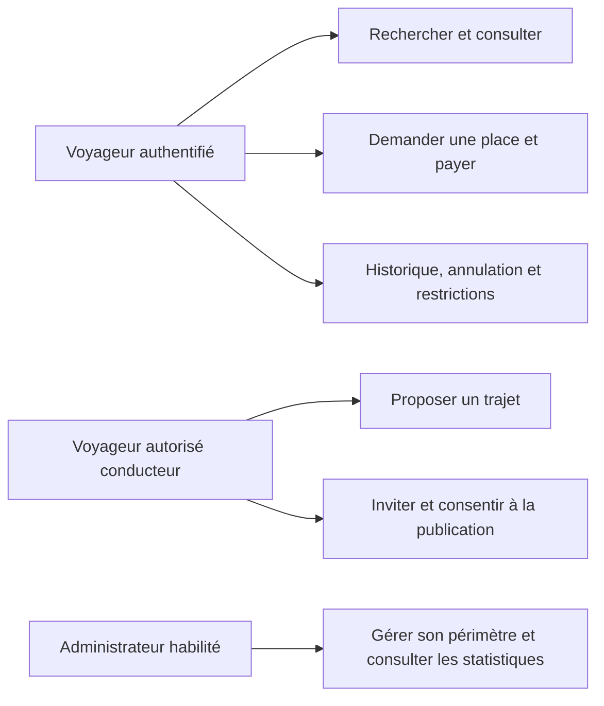

# Analyse métier — covoiturage belge

Issue #2 ; branche `feature/issue-2-analyse-transport`, créée depuis
`origin/develop` à `688190e`. Document proposé à validation avant modification
du modèle JPA. Il ne constitue pas une annonce de fonctionnalités livrées.

## Sources et priorité

Le PDF `Enonce_GestionTransport_Multiple_Covoiturage_MAJ.pdf`, version du
11 novembre 2026, a été lu intégralement (5 pages). Empreinte SHA-256 :
`E2FF359A5372FDF7D13C2DB195E7EF0A91B143A49A363675659DDF6DAF2C355E`.
Le fichier est conservé dans les Téléchargements du demandeur ; aucun exemplaire
ni extrait intégral n'est publié dans le dépôt.

Les instructions du demandeur précisent la version académique : villes belges,
conducteur réutilisant Voyageur, simulation de paiement, monolithe et interface
responsive. La décision ultérieure fixe le tarif actuel à 100 € par trajet,
soit 25 € par personne pour quatre places (issue #4, PR #10).
La décision définitive du 12 novembre remplace le modèle à capacité variable :
un chauffeur obligatoirement associé et quatre clients maximum, hors chauffeur.

## État réellement examiné

| Réutilisable sur la branche de nomenclature #9 | Adaptation nécessaire |
| --- | --- |
| Agence, Vehicule, Trajet, Voyageur, Reservation, Paiement, Restriction, IndisponibiliteService | Compléter les informations de covoiturage, sans recréer ces entités |
| Controllers → Services → Repositories, DTO, mappers et gestion d'erreurs | Étendre les contrats existants et leurs validations |
| Authentification JWT, session voyageur et administrateur, droits par agence | Droit de proposer un trajet et identité conducteur imposée par le backend |
| Réservation sous transaction et verrou pessimiste ; test PostgreSQL dernière place | Déplacer l'attribution définitive à la validation du paiement |
| Paiement simulé, confirmation, annulation et remboursement par statut | Expiration configurable, concurrence paiement/annulation et conservation des montants |
| Catégories GLOBAL/AGENCE/LIBRE et fenêtres 21/14/5 jours | VIP/LOCAL/LIBRE ; appliquer le délai à chaque réservation, pas uniquement à la création du trajet |
| Pages et services HTTP Angular, guards, intercepteur, FR/EN | Recherche réelle villes/date, conducteur, véhicules, disponibilité, cartes et responsive |
| Scheduler et historique des restrictions | Consentement de publication, expiration, motifs et absence de doublons |

Les limites vérifiées sont concrètes : prix et capacité fixes, organisateur ajouté
automatiquement comme passager, aucune ville, aucun droit de conduite, publication
privée forcée à J-1, charge des impayés à l'organisateur. Ces comportements ne
doivent pas être conservés comme règles de transport.

Les PR #8 (baseline) et #9 (nomenclature) sont ouvertes en brouillon, non fusionnées
lors de l'analyse. La PR #10 contient le tarif demandé. Leurs résultats de tests
ne décrivent donc pas encore le contenu de develop. Aucun travail n'est refait ici.

## Dictionnaire et périmètre minimal

- **Agence** : périmètre d'administration et d'autorisation locale ; pas de
  deuxième entité Zone si l'agence suffit.
- **Voyageur** : compte authentifié et catégorie de réservation.
- **Conducteur** : rôle d'un Voyageur ayant le droit de proposer ; aucune table
  Conducteur ni deuxième authentification. Le siège conducteur est hors capacité.
- **Vehicule** : immatriculation unique, marque, modèle, type, capacité passagers,
  disponibilité et agence éventuelle. Aucune gestion de capacité variable de flotte.
- **Ville** : code et libellé d'une liste centralisée exposée par l'API ; pas de
  table d'itinéraires, Google Maps, distance calculée ou géolocalisation.
- **Trajet** : départ, destination, départ daté, arrivée estimée, exactement un
  chauffeur, un véhicule, quatre places clients maximum, prix, type et statut.
- **Reservation** : demande d'un client pour une place, date, échéance et statut.
  Le montant est porté par le paiement existant ; pas de gestion de sièges numérotés.
- **Paiement** : simulation identifiée comme telle ; montant réellement validé,
  date, statut et lien avec la réservation, sans prestataire bancaire.
- **Confirmation / billet** : présentation de la réservation payée avec son
  identifiant ; pas de nouvelle table Billet indispensable à cette version.
- **Restriction** : suspension traçable liée à un fait, avec début, fin, motif,
  trajet/réservation concerné et état ; expiration sans effacer l'historique.

## Règles de réservation et de trajet

| ID | Règle cible | Source / contrôle |
| --- | --- | --- |
| C01 | Départ et destination doivent différer ; villes issues de la liste centrale | Demandeur ; tests service/REST |
| C02 | Toute paire de villes belges autorisées est possible, sans obligation de passer par Bruxelles | Demandeur ; recherche et création |
| C03 | Conducteur obligatoire et unique ; pour un voyageur, identité issue de l'authentification | PDF p.2 ; tests anti-usurpation |
| C04 | Un administrateur choisit un conducteur existant, autorisé et dans son périmètre | Demandeur ; tests administrateur local/global |
| C05 | Pas de réservation automatique pour le conducteur ; il ne consomme pas de place passager | PDF p.2 ; création sans réservation implicite |
| C06 | Quatre clients maximum, chauffeur exclu ; zéro réservation automatique du chauffeur | Décision définitive du 12 novembre ; refus de la cinquième confirmation |
| C07 | Véhicule disponible ; pas de chevauchement conducteur/véhicule | PDF p.2 ; transactions et tests d'affectation concurrente |
| C08 | Arrivée estimée après départ ; intervalle véhicule de référence 15 min, configurable | PDF p.2 ; trajets traversant minuit inclus |
| C09 | Horaires et indisponibilités de l'agence effective respectés | PDF p.2 ; agence du véhicule, sinon du conducteur si présente |
| C10 | VIP : G…, fenêtre maximale 21 jours ; local : S…, 14 jours ; libre : L…, 5 jours | PDF p.3 ; bornes exactes et refus au-delà |
| C11 | Le local peut consulter les autres zones mais réserve dans sa zone autorisée | PDF p.3 ; contrôle backend distinct consultation/réservation |
| C12 | Trajet privé visible/réservable seulement pour conducteur, invités autorisés et administrateur habilité | PDF p.2 et p.4 ; tests de confidentialité |
| C13 | Publication des places privées restantes à H-24 seulement avec accord préalable enregistré | PDF p.2 ; pas de conversion ni de pénalité automatique sans accord |
| C14 | Une demande impayée n'attribue pas définitivement une place ; le premier paiement validé gagne | PDF p.2–3 ; concurrence sur le paiement |
| C15 | Une confirmation exige paiement validé, délai respecté et capacité réelle sous verrou | PDF p.3 ; aucune sur-réservation |
| C16 | Une réservation impayée expire à son échéance configurable | PDF p.3 ; traitement idempotent |
| C17 | Une annulation autorisée d'une réservation confirmée libère ses places ; demande impayée sans effet sur les places confirmées | PDF p.3 ; historique conservé |
| C18 | Annulation du trajet par conducteur : réservations traitées et paiements remboursés en simulation selon politique validée | PDF p.3 ; transaction globale et historique |
| C19 | Une restriction active ou une dette interdit une nouvelle réservation | PDF p.3 ; pas de contournement par appel REST direct |
| C20 | Admin local limité à son agence ; admin global réseau entier | PDF p.4 ; filtrage des listes et opérations unitaires |

Les fenêtres de réservation sont inclusives : de maintenant jusqu'à J+21, J+14
ou J+5 selon la catégorie, jamais après le départ. La logique sera centralisée
dans les services existants avec une horloge injectable pour des tests stables.
Un administrateur ne peut pas changer librement les identifiants envoyés pour
contourner une réservation ou un paiement appartenant à un autre voyageur.

## Paiement et concurrence : changement nécessaire, mécanisme réutilisé

Le code actuel bloque une place dès la création d'une demande. Ce comportement
contredit C14. On conserve les transactions et le verrou pessimiste PostgreSQL,
mais le point d'attribution devient la confirmation du paiement dans PaiementService.
Une demande en attente peut être refusée si le trajet est déjà complet, mais
elle ne soustrait pas une place aux autres candidats au paiement.

Ordre commun : verrouiller le trajet, recharger les états réservation/paiement,
vérifier propriétaire, échéance et capacité confirmée, puis confirmer paiement
et réservation atomiquement. Annulation et expiration suivent le même ordre
de verrouillage. Une requête répétée ne peut pas débiter ou confirmer deux fois.

Le test actuel de concurrence à la création sera conservé comme preuve du socle
et adapté au nouveau point de confirmation : deux transactions de paiement pour
la dernière place, une seule confirmation. La concurrence entre création de
trajets devra aussi verrouiller véhicule et conducteur pour éviter deux créneaux
incompatibles validés simultanément. Pas de Redis, de file ou de service dupliqué.

## Cas d'utilisation

1. **Rechercher** : choisir deux villes et une date ; obtenir uniquement des
   trajets publics réels avec conducteur, véhicule, prix et places calculées.
2. **Réserver/payer** : s'authentifier, vérifier catégorie et autorisation,
   créer une demande, simuler le paiement, consulter la confirmation ou un refus
   de capacité compréhensible, puis retrouver l'historique.
3. **Proposer** : conducteur autorisé connecté, sélectionner véhicule et villes,
   horaires/prix/type, valider ; identité conducteur imposée par le backend.
4. **Inviter** : conducteur d'un trajet privé, sélectionner voyageurs éligibles,
   créer leurs demandes via la logique existante ; ne pas créer d'utilisateur.
5. **Annuler** : vérifier propriétaire et conditions ; préserver réservation,
   paiement et remboursement simulé dans l'historique.
6. **Administrer** : gérer les ressources de son périmètre et consulter des
   statistiques issues de données réelles, filtrées par période/agence/statut.

## Décisions métier à valider, sans valeurs inventées

- **D01 — décision résolue et validée par le demandeur le 12 novembre** : quatre
  clients maximum, 25 € par client, 100 € de référence si complet. Un seul tarif
  central, calculs BigDecimal. Recettes : clients payants × 25 € ; aucune facturation
  des places inoccupées. Aucun véhicule à six ou huit places à gérer. Les anciens
  paiements restent immuables. Cette décision remplace la proposition précédente.
- **D02 — délai impayé** : configurable ; aucune durée imposée par le PDF. Une
  valeur de démonstration devra être explicitement nommée et documentée.
- **D03 — annulation/remboursement** : délai gratuit, frais et conditions tardives
  non chiffrés ; ne pas facturer arbitrairement. Validation nécessaire avant activation.
- **D04 — absence/abus** : l'absence est déclarée par un acteur habilité, pas
  détectée par GPS ; seuil d'abus et fenêtre d'observation à définir. Suspension
  de référence 7 jours configurable, un fait ne générant qu'une restriction.
- **D05 — paiement** : simulation uniquement, affichée comme telle dans l'UI.
  Pas de transfert réel, pas de traitement des cartes bancaires.

Les restrictions expirées cessent d'interdire la réservation par comparaison de
date, sans suppression d'enregistrements. Les automatismes dont le déclencheur
n'est pas validé restent désactivés ou explicitement en attente de décision.
