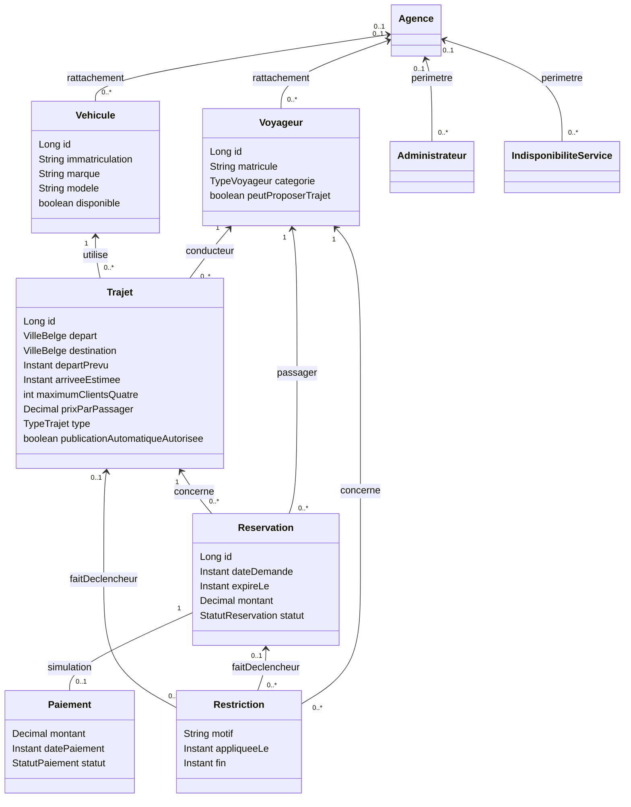

# Modèle de covoiturage proposé — issue #2

À valider avant les changements JPA de l'issue #3. Ce modèle réutilise les huit
entités métier de la PR #9 ; aucun nouveau service d'utilisateurs ni table
Conducteur, Zone, Route routière ou Billet n'est proposé.

## Classes et cardinalités

Le diagramme exprime le modèle logique, pas des noms de champs à dupliquer.
Par exemple, dateDebut/dateFin existants portent le départ et l'arrivée estimée.
L'association organisateur actuelle devient le conducteur autorisé : un seul
lien JPA, pas deux liens contenant le même utilisateur.

Le tarif total de référence est 100 €, le prix client 25 €, le maximum quatre
clients. Ce maximum est une règle centrale, pas une colonne supplémentaire par
véhicule ou trajet ; le champ du diagramme est conceptuel. Le chauffeur est exclu.
Le paiement conserve son montant historique, sans recalcul rétroactif.

## Modèle relationnel et correspondance physique

Les noms physiques historiques sont maintenus pendant la transition afin que
le renommage Java ne recrée ni tables ni relations.

| Table physique existante | Entité réutilisée et évolution minimale |
| --- | --- |
| sites | Agence : nom, localisation/adresse, horaires et intervalle entre utilisations |
| membres | Voyageur : matricule unique, identité, mot de passe, catégorie, agence éventuelle ; ajout du droit de proposer |
| administrateurs | Administrateur : comptes distincts déjà présents, type global/agence et agence éventuelle conservés |
| terrains | Vehicule : immatriculation, marque, modèle, type et disponibilité ; pas de capacité variable ni de gestion de flotte complexe |
| matches | Trajet : conserver terrain_id et organisateur_id comme FK du véhicule et du chauffeur ; ajouter villes et consentement de publication ; maximum clients centralisé à quatre |
| reservations | Réutiliser match_id, membre_id et date de création ; une place par réservation, échéance calculée et statut explicites |
| paiements | Paiement : réservation, montant, date et statut ; historique remboursé conservé |
| penalites | Restriction : conserver membre_id, date_fin, motif ; compléter fait déclencheur, date d'application et traçabilité |
| jours_fermeture | IndisponibiliteService : date, motif, périmètre global/agence conservés |

Les champs Java/JSON cibles utilisent VIP, LOCAL, LIBRE. Le convertisseur
TypeVoyageur existant sera adapté ainsi : VIP ↔ GLOBAL, LOCAL ↔ SITE,
LIBRE ↔ LIBRE. Le type AGENCE des administrateurs reste inchangé dans le code
et continue à correspondre à SITE en SQL. Une substitution globale serait erronée.

VilleBelge est une liste centrale de codes et libellés exposée au frontend,
comprenant Bruxelles, Mons, Charleroi, Namur, Liège, Anvers, Gand, Louvain,
Nivelles et Wavre. Les exemples de liaisons sont des enregistrements de
démonstration, pas une liste de couples interdits/autorisés codée en dur.

## Contraintes et index à vérifier sur PostgreSQL

- FK conducteur et véhicule obligatoires pour tout nouveau trajet ; conducteur
  autorisé vérifié par le service, distinct des réservations passagers.
- Immatriculation unique pour les véhicules qualifiés ; pas de plaque inventée
  lors de la reprise d'une ancienne ressource sportive.
- Quatre confirmations clients maximum sous transaction/verrou. Le chauffeur
  ne crée pas de réservation et ne peut pas acheter une place de son propre trajet.
- Départ différent de destination ; arrivée strictement après départ ; prix
  positif ou nul selon politique validée, jamais un montant négatif.
- Une seule demande active par paire trajet/voyageur, avec index unique partiel
  sur les statuts actifs. Les annulations/expirations restent historisées et une
  nouvelle demande peut être créée après résolution de l'ancienne.
- Paiement unique par réservation dans cette simulation, pour réutiliser le
  OneToOne actuel ; une tentative répétée ne crée pas un deuxième débit.
- Index de recherche sur départ/destination/date/type/statut et de contrôle
  sur conducteur/créneau et véhicule/créneau. Les verrous métier restent requis.
- Un fait/cause ne génère qu'une restriction ; index d'idempotence à définir
  selon le lien réservation/trajet, sans empêcher deux faits distincts légitimes.

Les statuts actuels sont conservés autant que possible. EXPIREE est nécessaire
pour distinguer expiration et annulation volontaire. Les états terminés prévus
par le PDF ne doivent être ajoutés qu'avec une transition métier et un test réels.
Les CHECK PostgreSQL des enums doivent être inspectés et migrés explicitement
avant toute écriture d'une nouvelle valeur.

## Protection et qualification des anciennes données

1. Inventorier les tables, contraintes et comptes sans écriture. Sauvegarder
   avec pg_dump avant toute migration validée ; vérifier la restauration dans
   une base distincte. Ne jamais supprimer le volume Docker existant.
2. Préparer le schéma sur une base isolée avec copie contrôlée. Conserver
   ddl-auto existant jusqu'à validation d'une autre stratégie ; ne pas ajouter
   Flyway/Liquibase simplement pour ce chantier.
3. Ajouter les données nouvelles de façon compatible avec les anciennes lignes.
   Une ancienne ressource sportive non qualifiée n'est pas un véhicule réservable.
   Les nouveaux DTO imposent ces champs, les anciennes lignes restent consultables
   en historique et exclues de l'exploitation jusqu'à qualification explicite.
4. Ne pas attribuer automatiquement le droit de conduire aux anciens voyageurs.
   L'ancien organisateur n'est pas une preuve de qualification conducteur.
   Un ancien trajet sans villes ou véhicule qualifié n'est pas proposé à la vente.
5. Conserver les montants des trajets, réservations, paiements et remboursements.
   Ne pas convertir les anciens montants 60/15 en 100/25 par UPDATE global.
6. Les calculs nouveaux utilisent BigDecimal. Préserver les anciennes colonnes
   et paiements tant qu'une migration NUMERIC n'est pas validée ; convertir les
   valeurs à la frontière, sans UPDATE global ni arrondi d'anciens paiements.
7. Ne pas reprendre nbPassagersActuels comme vérité de capacité : le socle inclut
   des demandes impayées et l'organisateur. Les places confirmées sont calculées
   selon une règle unique sous verrou, sans compteur supplémentaire. Si le
   compteur actuel est conservé, seules confirmation et annulation confirmée
   le modifient dans la même transaction ; les demandes impayées ne le modifient pas.
   Les anciennes lignes restent hors exploitation jusqu'à qualification.
8. Comparer identifiants, sommes, relations et historiques avant/après ; démarrer
   avec ddl-auto=validate sur la copie ; obtenir validation avant base métier.

## API et responsabilités

Adapter CreateTrajetRequest, TrajetRequest, TrajetDto, VehiculeRequest/Response
et leurs mappers existants. Un seul flux de création dans TrajetService gère
conducteur connecté ou conducteur sélectionné par administrateur habilité.
L'identifiant conducteur soumis par un voyageur ne doit jamais remplacer celui
de son authentification. Même règle pour réserver/payer au nom d'un tiers.

Réutiliser ReservationService pour les demandes et invitations, PaiementService
pour la simulation et confirmation. Les invitations peuvent utiliser les
réservations privées créées par le conducteur ; aucun système d'invitation ou
utilisateur parallèle n'est nécessaire. L'historique d'un voyageur reste lisible
sans donner accès aux données privées des autres passagers.

Le scheduler existant devient le point unique d'orchestration des expirations
et publications consenties ; pas de nouveaux traitements concurrents dupliqués.
Les règles et requêtes restent dans leurs couches existantes.
