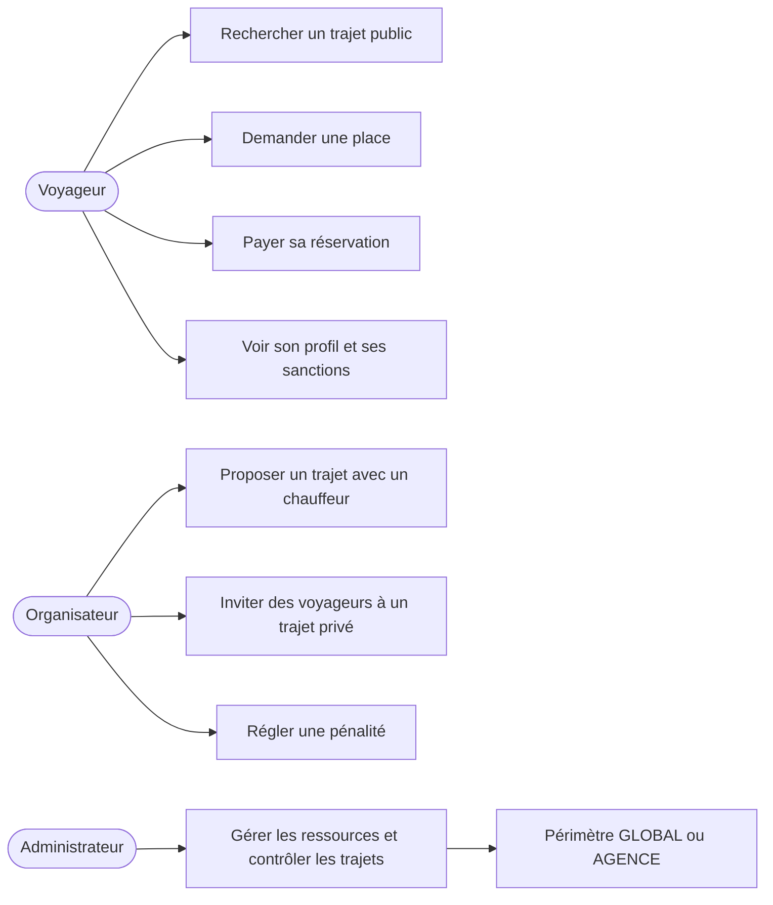
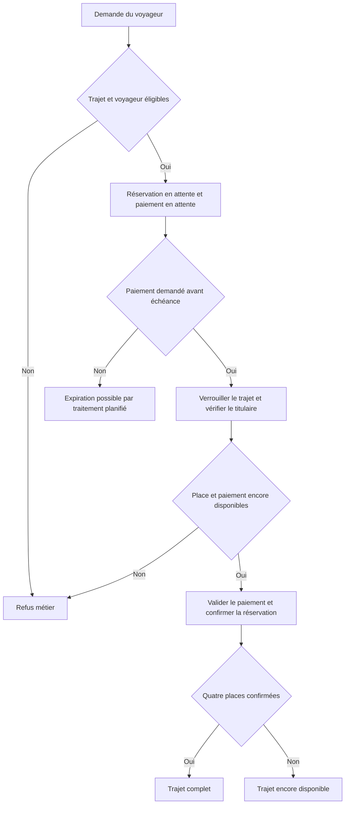
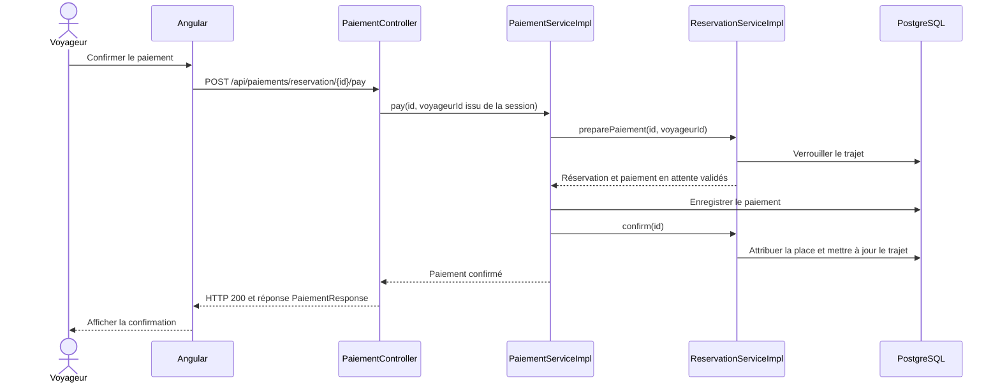
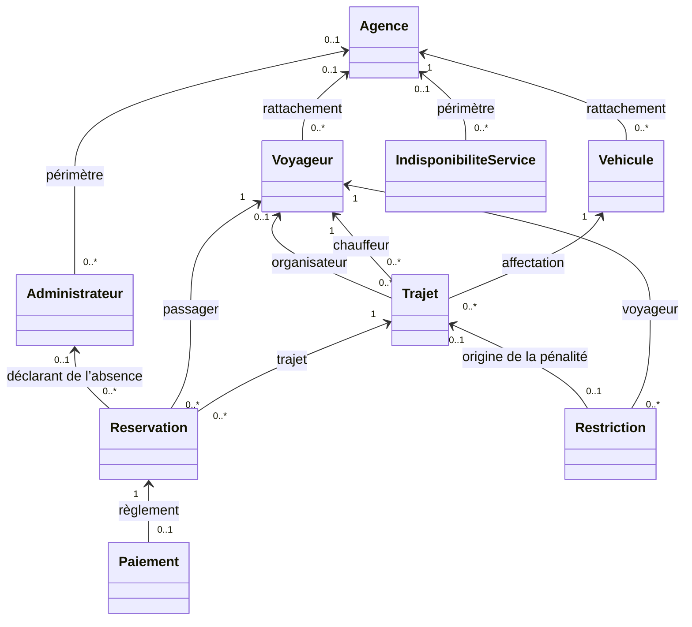
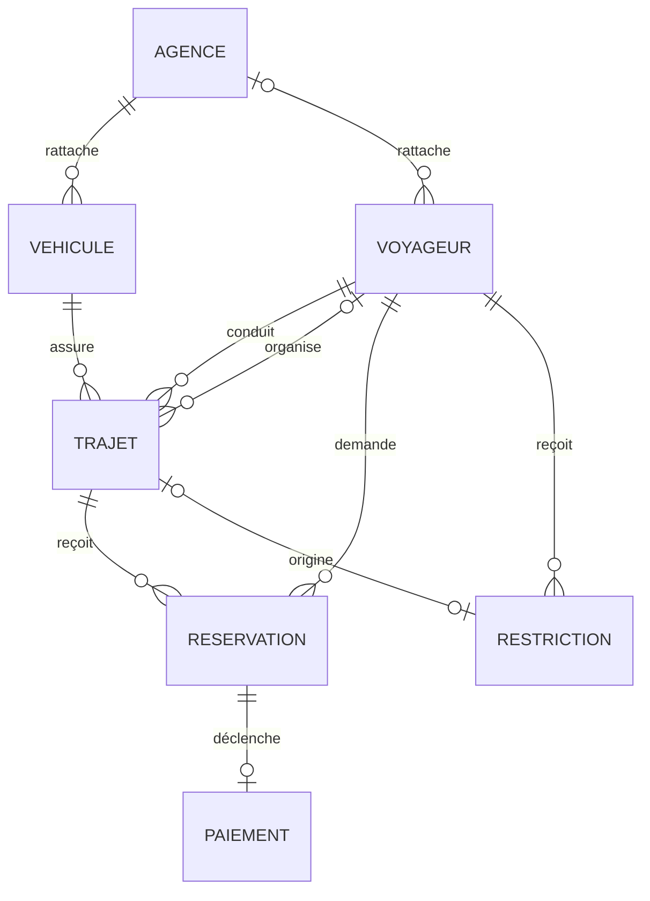

# Diagrammes de GestionTransport-Multiple

Référence fonctionnelle `d74caeb` intégrée par la PR #37. Les associations représentées sont issues des entités sous `src/main/java/com/transport/gestiontransport/entity/`. Les associations facultatives de données historiques sont indiquées.

## Cas d’utilisation

## Activité de réservation et paiement

## Séquence de paiement

## Classes principales

## Modèle conceptuel

Un voyageur peut exercer les rôles de chauffeur, organisateur ou passager selon l’association. Les règles de réservation empêchent le chauffeur d’occuper l’une des quatre places passagers du même trajet. Les contraintes de disponibilité comparent les horaires des trajets actifs pour le même véhicule ou chauffeur.

## Modèle logique relationnel

Les clés primaires sont les identifiants des entités. Les clés étrangères entre parenthèses peuvent être nulles.

| Relation | Identifiants référencés |
| --- | --- |
| AGENCE | Identifiant de l’agence |
| VEHICULE | agence |
| VOYAGEUR | (agence) |
| ADMINISTRATEUR | (agence) |
| INDISPONIBILITE_SERVICE | (agence) |
| TRAJET | véhicule, chauffeur, (organisateur) |
| RESERVATION | trajet, voyageur, (administrateur déclarant l’absence) |
| PAIEMENT | réservation, unique |
| RESTRICTION | voyageur, (trajet d’origine), unique lorsqu’il est renseigné |

## Modèle physique PostgreSQL

| Objet physique | Contraintes et preuve |
| --- | --- |
| `trajets` | `vehicule_id` et `chauffeur_id` obligatoires. `voyageur_organisateur_id` référence `voyageurs.id`. Les invariants Transport bornent le nombre de passagers et contrôlent les statuts. |
| `reservations` | `trajet_id` et `voyageur_id` obligatoires. L’index partiel `ux_reservations_actives` cible les demandes actives du même voyageur sur un trajet. |
| `paiements` | `reservation_id` obligatoire et unique via le mapping un-à-un. |
| `restrictions` | Identifiant d’événement unique. `trajet_origine_id` est facultatif et unique lorsqu’il existe. La migration de suspension ajoute le contrôle de 168 heures. |
| Prix, montants et soldes | Le candidat de référence utilise les flottants sur plusieurs colonnes. La [PR #47](https://github.com/Zoom225/GestionTransport-Multiple/pull/47) propose `numeric(19,2)` et une migration explicite. `restrictions.montant_penalite` est en `numeric(12,2)`. |

Sources de contraintes. [Invariants](../../scripts/migrations/issue-3-invariants-transport.sql), [organisateur](../../scripts/migrations/issue-8-organisateur-penalite.sql), [suspension](../../scripts/migrations/issue-9-suspension-168h.sql).
